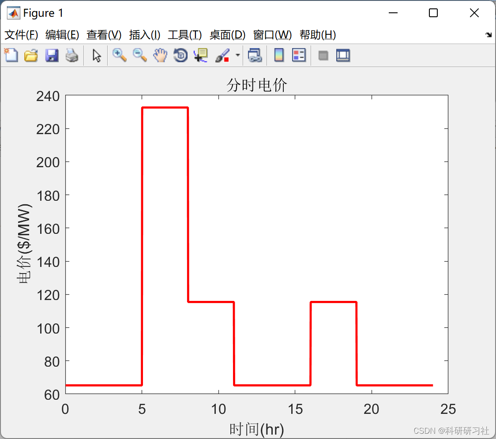
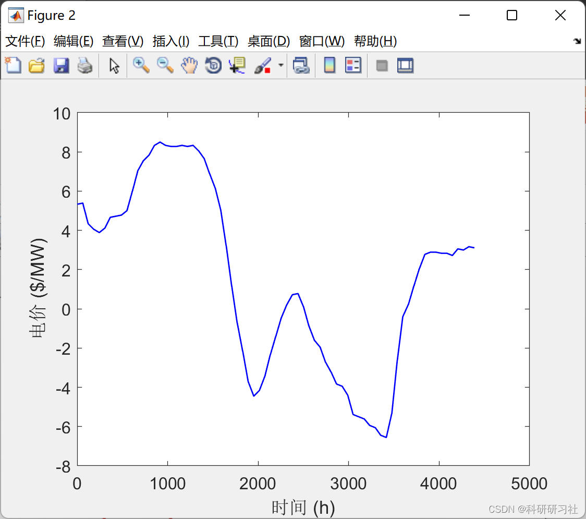
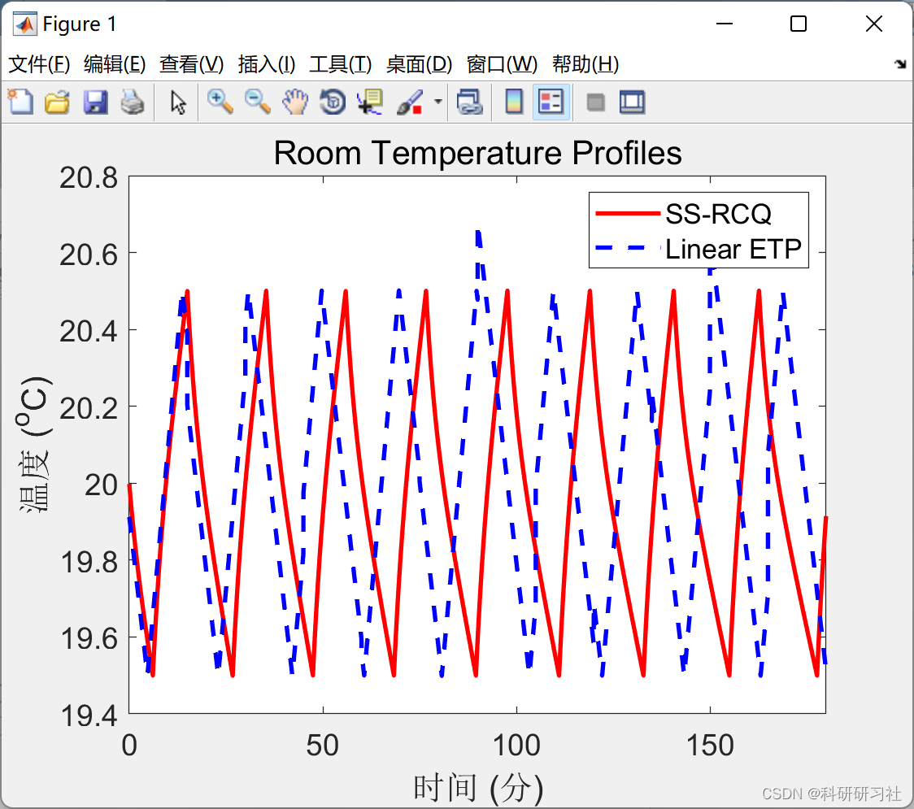
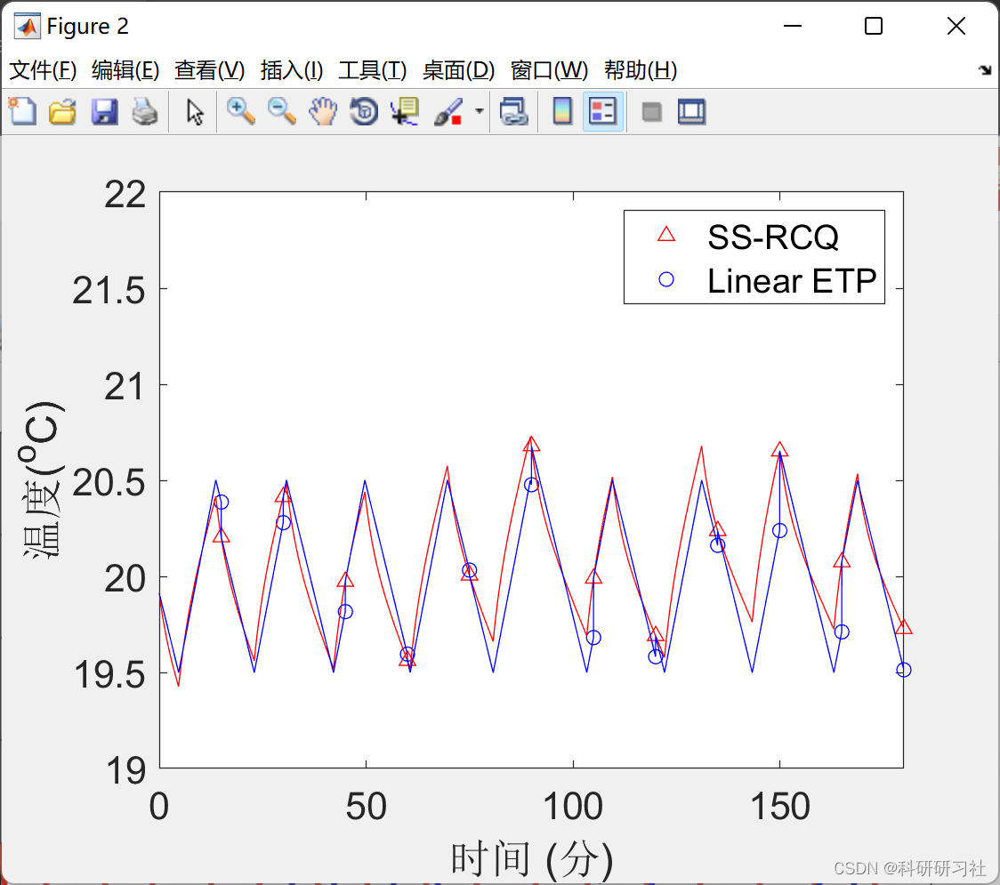
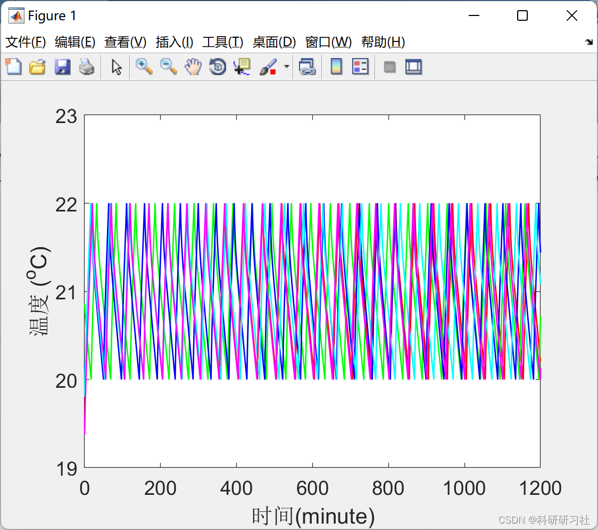
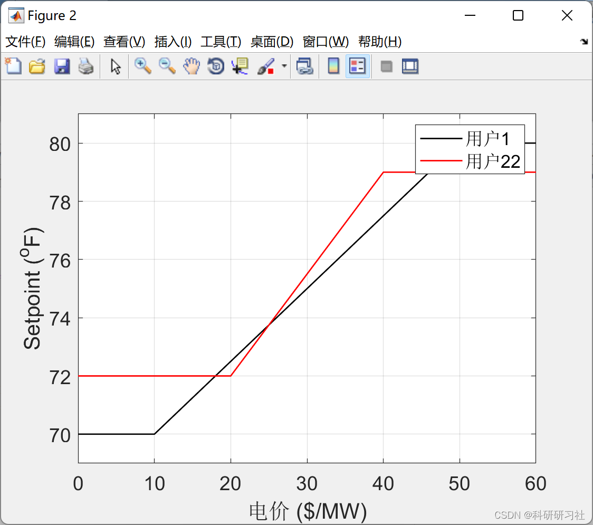

# Research on Demand Response in Smart Grids (Matlab Code Implementation)

1. Overview, smart grid demand response can reduce peak electricity demand on the grid, improve grid operation stability and reliability, especially by enabling the grid to accommodate intermittent renewable energy generation through demand response.
The global progress and benefits of demand response are comprehensively reviewed in the literature [3]: In North America, the United States leads in demand response capacity, accounting for over 80% of the global market share. Pacific Gas & Electric Company (PG&E) in California offers its commercial and residential customers smart air conditioning demand response programs, which control the operation of air conditioning by cycling aggregated cooling loads during peak electricity usage periods, especially during summer when hundreds of thousands of air conditioners operate simultaneously. San Diego Gas & Electric Company and Southern California Edison also offer their respective user response projects. Texas Power & Light provides an irrigation electricity management program for agricultural users. Florida Power & Light Corporation offers a business electricity demand reduction project.The New York Independent System Operator (ISO) offers four types of utility demand response projects to industrial and commercial users: emergency demand response projects, special circumstances resource projects, one-day advance demand response projects, and demand side auxiliary service projects.
2 Running Results Editing
Editing
Editing
Editing
3 Matlab Code and Reference Article This document only showcases a portion of the code, please refer to:
clear all\nclose all\n\nprice = [65.2*ones(60,1);65.2*ones(60,1);65.2*ones(60,1);65.2*ones(60,1);65.2*ones(60,1); ...\n         232.64*ones(60,1);232.64*ones(60,1);232.64*ones(60,1);115.45*ones(60,1); 115.45*ones(60,1);115.45*ones(60,1);...\n        65.2*ones(60,1);65.2*ones(60,1);65.2*ones(60,1);65.2*ones(60,1);65.2*ones(60,1); ...\n        115.45*ones(60,1); 115.45*ones(60,1);115.45*ones(60,1);...\n        65.2*ones(60,1);65.2*ones(60,1);65.2*ones(60,1);65.2*ones(60,1);65.2*ones(60,1)];\ndeltT = 1;         % Time steps in minute\nt = 1:deltT:24*60;   %The time sequence\n\nfigure(1)\nset(gcf,'DefaultAxesFontSize',12)  %<--------set character size\nset(gcf,'DefaultTextFontSize',12)\nplot(t/60,price,'r','LineWidth',1.8)\nxlabel('Time(hr)')\nylabel('Electricity price($/MW)') \ntitle('Time-of-use electricity pricing')\n\n\n\nsub_loadTemperaturewinter % Load outdoor temperature profile (a day)\nTout = [];    \nday = 1\nnumberOfDay = 3\n\nfor i = 1:24*numberOfDay\n    if Tout24(24*day+i) ~= Tout24(24*day+i+1)\n        Tstep0 = (Tout24(24*day+i+1)-Tout24(24*day+i))/(60/deltT);\n        Tout = [Tout [Tout24(24*day+i):Tstep0:Tout24(24*day+i+1)]];\n    else\n        Tout = [Tout Tout24(24*day+i)*ones(1,(60/deltT))];\n    end\nend\nTout = (Tout-32)*5/9;\nfigure(2)\nset(gcf,'DefaultAxesFontSize',12)  %<--------set character size\nset(gcf,'DefaultTextFontSize',12)\nplot(Tout,'b','LineWidth',1)\nxlabel('Time (h)')\nylabel('Electricity price ($/MW)') \n  
​  

## Images

<!-- PAYMENT_BLOCK -->

## Get this dataset

- Payment link (Stripe): [Buy now](https://buy.stripe.com/3cs8yP7sY87d0vu9AB)
- Payment QR code: 

<!-- /PAYMENT_BLOCK -->
